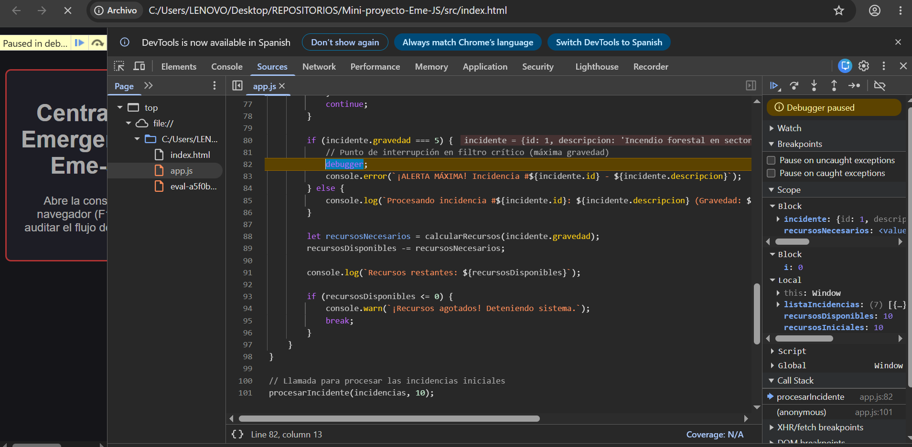

# Diario de Depuración - Central de Emergencias Eme-JS

## 1. Evidencias de Depuración con DevTools

### 1.1. Inspección de Ámbito (Scope) y Pila de Llamadas (Call Stack)

Pausa de ejecución en punto crítico de filtrado (`debugger;` en incidencia de gravedad 5). Se observa el estado congelado de variables locales (`incidente`, `recursosDisponibles: 10`, índice `i: 0`) y la traza en la pila de llamadas (`procesarIncidente` en línea 82):

---

### 1.2. Traza Final de Ejecución en Consola

Salida completa de la consola auditando el filtrado por estados, avisos de alerta máxima (`console.error`), cálculo dinámico de recursos y detección de recursos agotados (`console.warn` con detención por `break`):

---

## 2. Reflexión sobre Pair Programming y Control de Errores

### 2.1. Experiencia de Pair Programming

La metodología de programación en pareja (*Driver/Navigator*), alternando los roles de Conductor y Navegador entre ambos integrantes, resultó determinante para la calidad del código y la fluidez del desarrollo. Mientras el Conductor se concentraba en la implementación sintáctica, el formateo y la manipulación inmediata del DOM y las estructuras de datos, el Navegador mantuvo una perspectiva global de arquitectura, buenas prácticas y anticipación de casos límite. Esta sinergia permitió iterar rápidamente con revisiones continuas antes de consolidar cada commit en el repositorio.

### 2.2. Control de Errores Detectados por el Navegador

A lo largo de las sesiones de trabajo, la labor de supervisión del Navegador permitió identificar y corregir fallos relevantes que el Conductor había pasado por alto:

1. **Falta de encapsulamiento y modularidad:**
   * **Commit asociado:** [`33e582f`](https://github.com/bbaakkuu-svg/Mini-proyecto-Eme-JS/commit/33e582f471e5f77ff95c2c78c16cbdf9f6625899)
   * **Roles:** **Driver:** Migue | **Navigator:** Baku
   * *Diagnóstico:* Inicialmente, el procesamiento de las alertas se ejecutaba como un bucle suelto en el ámbito global del script, operando sobre variables de estado globales (`let recursosDisponibles = 10;`).
   * *Solución:* El Navegador detectó la mala práctica de ensuciar el *scope* global y promovió la encapsulación de toda la lógica dentro de la función modular `procesarIncidente(listaIncidencias, recursosIniciales)`. Asimismo, advirtió la deficiencia visual y de contraste en `index.html`, actualizando el color de fondo de `#363030` a un tono oscuro normalizado `#1e1e24` para garantizar legibilidad.
2. **Punto de interrupción indiscriminado en el depurador:**
   * **Commit asociado:** [`75450d5`](https://github.com/bbaakkuu-svg/Mini-proyecto-Eme-JS/commit/75450d5ae4c8b988c6e02905179582988f603c68)
   * **Roles:** **Driver:** Baku | **Navigator:** Migue
   * *Diagnóstico:* Se había posicionado una sentencia `debugger;` incondicional al inicio del bucle, obligando a pausar la ejecución en cada una de las iteraciones independientemente del estado o gravedad.
   * *Solución:* El Navegador propuso ubicar estratégicamente la parada únicamente dentro de la estructura de control de alerta crítica (`if (incidente.gravedad === 5)`), aislando el escenario de máximo riesgo y optimizando la auditoría.
3. **Inalcanzabilidad del límite de recursos del sistema:**
   * **Commit asociado:** [`75450d5`](https://github.com/bbaakkuu-svg/Mini-proyecto-Eme-JS/commit/75450d5ae4c8b988c6e02905179582988f603c68)
   * **Roles:** **Driver:** Baku | **Navigator:** Migue
   * *Diagnóstico:* Con la colección inicial de 6 incidencias y 10 recursos asignados, el cálculo matemático siempre finalizaba con saldo positivo (1 recurso restante), de modo que la condición de seguridad `recursosDisponibles <= 0` jamás se alcanzaba y el `console.warn` quedaba inoperativo.
   * *Solución:* Se identificó el caso borde y se añadió una séptima incidencia pendiente para forzar el agotamiento de recursos y validar fehacientemente la detención por `break`.